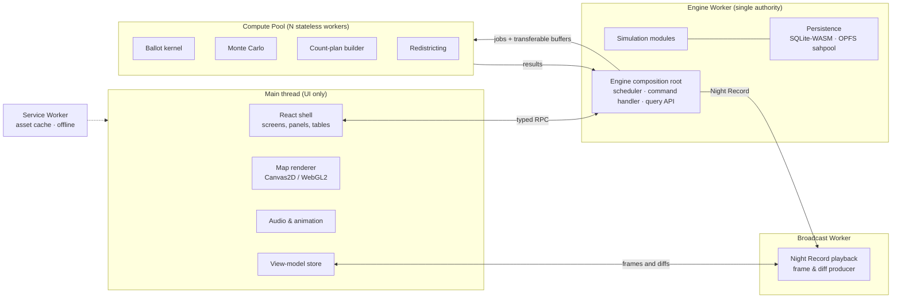

# 02 — Application Architecture

## 2.1 Runtime topology



| Thread | Owns | Never does |
|---|---|---|
| **Main** | DOM, React, map canvases, audio, input, routing | Simulation math, database access, anything over ~4 ms |
| **Engine Worker** | The universe: clock, scheduler, every simulation module's state, the **only** SQLite connection | Rendering |
| **Compute Pool** (`min(4, hardwareConcurrency − 1)` workers) | Nothing persistent. Pure functions from inputs to outputs. | Talking to the DB or holding state between jobs |
| **Broadcast Worker** | The in-memory Night Record of the election being viewed, its indexes and the playback clock | Changing any data |
| **Service Worker** | Cached, content-hashed static assets (app, WASM, geography packs) | Touching universe data |

**Why one engine worker.** `opfs-sahpool` gives exclusive access to the database file, and a single writer
removes every concurrency hazard around the archive. Parallelism comes from the compute pool, which
receives sharded inputs (for example, one state per job) and returns results that the engine merges in
**canonical order**. That order makes results identical regardless of the number of workers.

## 2.2 Module map and layering

The 20 systems required by spec §2.4 map to modules arranged in strict layers. A module may import only
from its own layer or from lower layers. dependency-cruiser fails CI on any upward or circular import.

```
L5  Record & analysis   archive · analytics
L4  Observers           polling · forecasting · projections · broadcast        (information firewall)
L3  Electoral           calendar · primaries · elections · electorate · ballots · counting
L2  Dynamics            events · campaigns · careers · government
L1  World state         population · parties · politicians · institutions · economy
L0  Foundation          core (rng, math, time, codecs, ids) · geo · rules
X   Cross-cutting       persistence (implements repository interfaces) · engine (composition root)
UI  apps/web            talks to engine only through the Engine API
```

| Spec §2.4 system | Module | Layer | Key responsibilities |
|---|---|---|---|
| 1 Geographic data | `geo` | L0 | Geography packs, Base Units, atoms, reporting jurisdictions, boundary versions, crosswalks, adjacency |
| 2 Population & demographics | `population` | L1 | County×cohort tables, Base Unit marginals, eligible electorate, annual evolution, census |
| 3 Political parties | `parties` | L1 | Party entities, platforms in issue space, brand, organization strength |
| 4 Politicians & careers | `politicians` (identity, traits), `careers` (decisions) | L1/L2 | Persistent people, tiered detail, career decision model |
| 5 Government institutions | `institutions` | L1 | Offices, chambers, terms, succession and vacancy rules |
| 6 Economy | `economy` | L1 | National and state macro series, releases with lags |
| 7 Political events | `events` | L2 | Hazard-driven event chains with causes and consequences |
| 8 Campaigns | `campaigns` | L2 | Resources, valence, ads, ground game, debates |
| 9 Primaries | `primaries` | L3 | Nomination calendars, delegate math, conventions |
| 10 Polling | `polling` | L4 | Pollsters, fieldwork, publication, averages |
| 11 Forecasting | `forecasting` | L4 | Monte Carlo forecasts, forecast history |
| 12 Elections | `elections` | L3 | Contests, ballots per Base Unit, methods (plurality, majority, RCV, top-two, Electoral College) |
| 13 Ballot generation | `electorate` (preference, turnout, mode) and `ballots` (kernel, sealing) | L3 | The shared-electorate realization |
| 14 Vote counting | `counting` | L3 | Count plans, wire feed, canvass, recount tabulation |
| 15 Race projections | `projections` | L4 | Wire expected-vote model, decision desks, voter survey |
| 16 Election-night broadcasting | `broadcast` | L4 | Alerts, commentary, playback engine |
| 17 Historical archives | `archive` | L5 | Immutable revisioned records, seals, queries |
| 18 Statistical analysis | `analytics` | L5 | Swing, trend, comparability, calibration reports |
| 19 Persistence | `persistence` | X | SQLite adapter, schema, migrations, import/export, backups |
| 20 User interface | `apps/web` | UI | Screens, map renderer, charts, audio |

`government` (L2) covers legislative sessions, bills, roll calls, vetoes and approval dynamics. `calendar`
(L3) turns office terms and rules into scheduled elections. `rules` (L0) holds jurisdiction-specific
election law, versioned by effective date.

### 2.2.1 The information firewall

L4 modules model *people who observe the universe*: pollsters, forecasters, decision desks and anchors. They
may read only the **Public Record** interface:

- published polls and their metadata
- released economic statistics (with release dates and lags)
- archived certified/unofficial results and the live **vote feed**
- public candidate facts (incumbency, offices held, fundraising reports, endorsements, announced events)
- their own past outputs (previous forecasts, previous calls)

They may **not** import `electorate`, `ballots`, or the latent fields in `population` and `parties`. The
only exception is the polling module's *fieldwork* step. A poll is a measurement, so it calls a narrow
`electorate.measure()` port that returns **sampled noisy responses**, never parameters. That port is the
only path through the firewall, and dependency-cruiser enforces this. As a result, forecasts and network
calls can be genuinely wrong for the right reasons.

## 2.3 Engine API

The UI and tests talk to the engine through a typed, versioned message API with three kinds of messages:

```ts
// Commands: change the universe; every one is appended to the command log.
type Command =
  | { kind: 'universe.create'; seed?: string; name: string; options: CreateOptions }
  | { kind: 'clock.advance'; until: AdvanceTarget }          // day | week | month | nextEvent | nextElection | nextElectionNight | date
  | { kind: 'clock.play'; speed: SimSpeed } | { kind: 'clock.pause' }
  | { kind: 'save.manual'; label: string } | { kind: 'save.backup' }
  | { kind: 'sandbox.*'; ... };                              // optional, logged, flagged in archive

// Queries: read-only, never mutate, safe to run while paused or playing.
type Query =
  | { kind: 'dashboard.summary' }
  | { kind: 'archive.countyHistory'; countyGeoId: string; offices?: OfficeKind[] }
  | { kind: 'archive.contest'; contestId: number; grain: 'state' | 'county' | 'cd' | 'bu' }
  | { kind: 'polls.average'; contestId: number; from: SimTime; to: SimTime }
  | { kind: 'forecast.history'; electionId: number }
  | ...;

// Subscriptions: push streams (clock ticks, news items, job progress).
type Subscription = 'clock' | 'news' | 'jobProgress' | 'storage';
```

Results carry provenance. Every number shown in the UI comes from a query result tagged with its source
(`archive`, `publicRecord`, `simulationTruth` or `estimate`), so the UI can label it honestly.

## 2.4 Scheduling model

The engine is a **discrete-event simulator**. It has no fixed tick. A priority queue holds events keyed by
`(simTime, priority, sequence)`. Systems register *processes* that run at their natural cadence:

| Cadence | Processes |
|---|---|
| Per event | Election lifecycle transitions, vacancies, deaths, scheduled debates, poll publication |
| Daily (06:00 ET) | Event hazards, campaign dynamics, poll fieldwork, news digest |
| Weekly / daily in the final 100 days | Forecast runs |
| Monthly | Economic releases (jobs report, CPI), approval aggregation |
| Quarterly | Fundraising reports, GDP releases |
| Annual (July 1) | Demographic evolution, aging, career reviews |
| Decennial | Census (April 1), apportionment (by December 31), redistricting processes |
| Election night | Handled by the Night Record (precomputed), not by per-minute engine ticks |

"Advance to next election" means "pop events until the next election event". Idle days cost
microseconds. Time is stored as **integer minutes since the Unix epoch (UTC)**, and local times are derived
through the `core/time` US time-zone engine (§3.6).

## 2.5 Determinism contract

1. **Keyed random streams.** Each random draw comes from a counter-based generator seeded by
   `H(universeSeed ‖ streamName ‖ key₁ ‖ key₂ …)` (for example `("ballots", electionId, stateFips)`). Results
   don't depend on evaluation order, sharding or worker count, and nothing hidden needs saving. A stream's
   state is a pure function of its key and a counter.
2. **Deterministic math.** `Math.exp/log/pow/sin` are implementation-defined in ECMAScript. The engine uses
   `core/math`, a TypeScript port of fdlibm for `exp`, `log`, `log1p`, `expm1`, `pow` and `erf`, so results are
   bit-identical across browsers and versions. Summations use a fixed order (and Kahan/pairwise summation
   where accuracy matters).
3. **No ambient inputs.** The engine never reads `Date.now()`, `Math.random()`, locale or screen size.
   Wall-clock time appears only in save metadata.
4. **Canonical ordering.** Map iteration, sorts (stable comparator with ID tiebreaks) and job merges follow
   documented orders.
5. **Command log.** User commands that affect the universe are logged with their simulated time. *Seed +
   configuration + command log + engine version* reproduce the universe. A CI test re-runs a logged universe
   and compares database content hashes.
6. **Engine-version ledger.** Model code changes between releases. The universe records which engine version
   simulated which period. History is never re-derived from code: the archive stores outcomes.

   **Engine version numbers** count the updates of the simulation itself: each update adds one to the major
   number, and only a really minor tweak adds .1. A release that changes only screens, maps or pages keeps the
   version, and the same seed then gives the same universe. Settings → About shows the version and the phase that
   last changed it. The list lives in `ENGINE_HISTORY` (`src/engine/universe.ts`). Until Phase 7.5, versions were
   named after the phase. Universes saved then keep the old name in their ledger, and it is read as the new one:

   | Engine | Old name | Updated |
   |---|---|---|
   | 1.0 | 0.1.0 | Phase 1 |
   | 2.0 | 0.2.0 | Phase 2 |
   | 3.0 | 0.3.0 | Phase 3 |
   | 4.0 | 0.4.0 | Phase 4 |
   | 5.0 | 0.5.0 | Phase 5 |
   | 6.0 | 0.6.0 | Phase 6 (the speed work after it left every result unchanged) |
   | 7.0 | 0.7.1 | Phase 7.1 |
   | 8.0 | 0.7.2 | Phase 7.2 |
   | 9.0 | 0.7.3 | Phase 7.3 |
   | 9.1 | 0.7.3.1 | After Phase 7.3: North Carolina's primary runoff threshold |
   | 10.0 | 0.7.4 | Phase 7.4 (Phase 7.5 changed only maps and pages) |
7. **Playback independence.** Election-night playback reads a stored record and cannot affect outcomes.

## 2.6 Error handling and recovery

- Every multi-step engine operation (for example, *finalize election*: seal results → write archive → update
  office terms → schedule inaugurations) runs inside an **operation journal** entry, with SQLite transactions per
  step. On restart, unfinished journal entries are resumed or rolled back.
- A worker crash surfaces a recoverable error. The engine restarts from the last committed state, and the
  in-memory hot state is rebuilt from the DB checkpoint plus the deterministic re-execution of the days since that checkpoint.
- **Web Locks** (`navigator.locks`) guarantee a universe is open in only one tab. A second tab shows "Open
  in another window" instead of corrupting anything.
