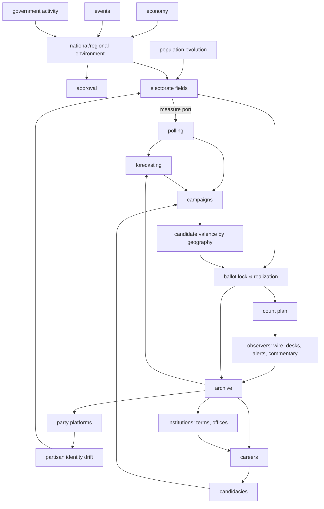

# 03 — Simulation Architecture

This document explains how the universe is structured and how its systems interact over time. The
mathematics is in [04-statistical-methodology.md](04-statistical-methodology.md).

## 3.1 The universe as state plus history

```
Universe
├── Static base (copied from the geography pack at creation, never mutated)
│     Base Units, counties, states, 2016 boundary plans, adjacency, reporting-jurisdiction definitions
├── Hot state (in Engine Worker memory, checkpointed to DB)
│     population fields · electorate fields · party platforms · economy state · campaign state · event state
├── Entity state (DB rows, updated in place with history tables)
│     people · offices · terms · parties · pollsters · networks · district plans · rules
└── History (append-only, immutable, sealed)
      elections · contests · results revisions · night records · polls · forecasts · events · econ releases
```

Two rules apply. **History is append-only.** **Hot state may be recomputed, but only forward in time.**

## 3.2 Interaction overview



Every arrow is a typed interface. The loop *results → careers/parties → candidacies → campaigns → results*
is what makes elections into chapters of a continuing history.

## 3.3 Election lifecycle (state machine)

Every contest goes through explicit, separately recorded stages, as spec §20.5 requires:

```
Scheduled ──► Filing ──► Primary/Nomination ──► Campaign ──► EarlyVoting ──► ElectionDay
   │                                                              │ (progressive lock)
   │                                                              ▼
   │                                                     BallotLock (results sealed: rev 0 "cast")
   │                                                              ▼
   │                                          Counting (Night Record: feed, projections)
   │                                                              ▼
   │                                    Canvass ─► Certified (rev N) ─► [Recount ─► Certified (rev N+1)]
   │                                                              ▼
   └──────── (vacancy) ──► SpecialElection           AssumptionOfOffice (term starts)
```

- **Projection** is a network event. **Certification** is a legal event. Only certification changes who
  holds office. A network can call a race that is later certified for the other candidate. That is rare, and
  the archive records it.
- **Elections exist only because law requires them.** `calendar` derives every election from
  `office.termSchedule` plus `rules` (for example U.S. House: every even year on the Tuesday after the first
  Monday in November, per 2 U.S.C. §7; Senate classes; each state's gubernatorial cycle; vacancy rules
  for specials). No election is generated "for activity".

## 3.4 Progressive ballot lock

Ballots are cast over weeks (mail and early voting), not in an instant:

- For each ballot mode `m`, the engine keeps a running, volume-weighted average of the short-term
  environment and campaign effects over that mode's casting window. Mail ballots returned in October
  reflect October, and Election Day ballots reflect Election Day.
- At the **lock instant** (polls opening on Election Day in the earliest time zone), the engine has every
  input fixed. The ballot kernel (§4.5) realizes the complete result, and the system seals it (SHA-256) as
  revision 0, *ballots cast*. From then on, nothing in the simulation can change a cast ballot. Counting
  only *reveals* the ballots. Canvass, curing and recounts produce explicit, logged revisions (§7.3).
- A late-breaking scandal therefore hurts the candidate among Election Day voters but not among the early
  vote already banked. This happens in reality, and it is emergent here.

## 3.5 Politicians and hierarchical detail

| Tier | Who | Detail | Count (2016) |
|---|---|---|---|
| **A** | President, VP, cabinet, congressional leaders, senators, governors, declared presidential contenders | Full trait vector, relationships, daily campaign agency, event participation | ~250 |
| **B** | House members, statewide officers, state legislative leaders, big-city mayors, serious challengers for Tier-A/B offices | Trait vector, career model each cycle, campaign agency in their contests | ~1,500 |
| **C** | State legislators, local officials, minor candidates, the "bench" | Compact record (identity, party, ideology, 4 skill scalars, office history). Promoted to B when they seek a B-level office. | ~8,000 at start, grows |

- Every person who appears on any ballot gets a **persistent `person_id`**. Tier C people are
  *materialized lazily*. When a contest needs a candidate pool, a deterministic generator keyed by
  `(state, office, year, slot)` creates them. The same seed always creates the same people, and once
  created they persist forever.
- **Pre-2016 backgrounds** (offices held before 2016, a narrative career summary) are generated as
  *biographical* facts and stored with `provenance = 'pre-simulation background'`. They never produce vote
  totals. The election archive begins with the first simulated election (§3.2 of the spec).
- **Names** come from public-domain frequency data (Census 2010 surnames, SSA given names by birth year), and
  name distributions are conditioned on birth year and region. A blocklist of prominent real politicians
  (current and recent members of Congress, governors and presidents, from the CC0
  `unitedstates/congress-legislators` dataset plus a curated governors list) rejects exact full-name
  matches.
- **Careers** are decided by an expected-utility model each filing season (§4.11). It weighs the value of the
  office, the estimated win probability (from the person's *perceived* environment, using only public
  information), age, the cost of giving up the current seat, ambition and scandal exposure. Promotions follow
  realistic ladders (state legislature → House → Senate/Governor → President) because candidate quality and
  name recognition are earned by holding offices.

## 3.6 Time and time zones

- Canonical time is **UTC minutes**. `core/time` implements the US time-zone rules required:
  Eastern, Central, Mountain, Mountain-no-DST (Arizona, except the Navajo Nation's polling places, which
  are handled by an exceptions table), Pacific, Alaska, Hawaii-Aleutian with DST (Aleutians west of 169.5°W),
  and Hawaii (no DST). It applies the post-2007 DST rules (second Sunday of March, first Sunday of November). The tz
  rules are data, so a simulated law changing DST is possible.
- **Every county maps to a zone.** Thirteen states are split across zones (FL, IN, KY, TN, MI, TX, KS, NE,
  SD, ND, ID, OR, AK). The county→zone table is compiled from 49 CFR Part 71 (the federal definition of
  time-zone boundaries). Poll closing is defined in *local* time by state law, so a state with two
  zones closes in two waves. In 2016 Kentucky's eastern counties close at 6:00 pm ET and its western counties at
  7:00 pm ET. Hawaii closes at 7:00 pm HST (midnight ET), and the Aleutians close at 8:00 pm HST/HDT (1:00 am ET).

## 3.7 Government and institutions

- **Offices** carry term schedules, eligibility (age, residency, term limits per state), and succession and
  vacancy rules. Examples: a Senate vacancy is filled by gubernatorial appointment plus a special election per
  state law; a House vacancy goes to a special election only; a governor vacancy goes to the LG or another
  successor per state constitution; the presidency follows the 25th Amendment and the Presidential Succession Act.
- **Chambers** track composition, leadership elections, majority control and (from Phase 6) roll calls. A bill
  is a vector in issue space plus salience. Members vote by ideological distance, party pressure and
  constituency lean. The 2016 rules apply: Senate cloture at 60 for legislation, a two-thirds veto override, and the
  budget-reconciliation exception. Laws feed back into the environment (approval and issue salience) and can
  change **election rules** (for example adopting RCV or all-mail voting). Rule changes take effect only
  through simulated legislation or ballot measures, starting from the real legal baseline of January 1, 2016.
- Government stays **subordinate** to elections. It runs at monthly or session granularity, with major
  bills (≈5–30 per Congress) simulated explicitly and the rest summarized as aggregate productivity.

## 3.8 Parties and the two-party guardrail

- Each party has a **platform** vector in the latent issue space (§4.1), an organizational strength score per
  state, and a brand (valence) score. Platforms move monthly under three forces: *vote seeking* (pull
  toward the swing electorate after losses), *activist pull* (toward the primary electorate), and
  *leader imprint* (the presidential nominee's position).
- **Realignment** is emergent. Groups whose positions are better represented by the other party drift in
  partisan identity, and generational replacement accelerates the drift (§4.2).
- The **two-party structure is structural, not scripted.** Plurality and winner-take-all rules impose a
  strategic-voting penalty on candidates seen as non-viable, and ballot-access costs and donor
  coordination make minor parties unable to sustain parity. Democrats and Republicans are institutional
  constants of the universe: even after landslides they persist, reposition and recover. Independents and
  minor parties can win individual contests (strong local candidates, three-way races, RCV jurisdictions),
  but the system never becomes multiparty. A long-run test asserts this property over 100-year runs on
  many seeds (§10).

## 3.9 Campaigns

Campaign state per candidacy: cash on hand, spending by geography (states for presidential races, the
district for House races, media regions approximated by Census CBSAs), staff and ground game, name
recognition by geography, and favorability. Daily dynamics:

1. Fundraising (skill, prospects, incumbency, national mood, small-donor enthusiasm).
2. Allocation. Presidential campaigns allocate by *voter power* (∂P(win)/∂share in each state, computed from the
   campaign's own forecast, which uses public information). Others spend where they run.
3. Effects. Persuasion (diminishing returns on spending), recognition growth, turnout mobilization,
   debate performance (skill plus noise), gaffes and controversies (from `events`).

Effects enter the vote model as **contest-specific valence by geography**, so they cause ticket
splitting, and they are bounded (a typical net effect is 1–3 points).

## 3.10 The Public Record

The Public Record is the observable face of the universe, and the only thing L4 observers read (§2.2.1): what a
journalist could know. It is materialized from history tables:

- results (as revisions are published), polls (on publication date), economic releases (with release lag),
- candidate filings and fundraising reports, endorsements, announced events and news items,
- the wire's live vote feed (on election nights).

The UI defaults to the Public Record too. *Simulation truth* views (latent partisanship, true current
vote intention, true remaining vote) exist for analysis, are clearly labeled, and are hidden during a live
election night unless the user opts in. This prevents spoilers.
