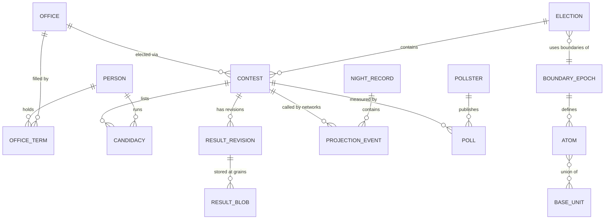

# 05 — Data Architecture

## 5.1 Storage layout

```
OPFS (origin private file system, managed by opfs-sahpool)
├── universes/
│   ├── u-<uuid>.sqlite3            one universe = one SQLite database (the save)
│   └── u-<uuid>.backup-<n>.sqlite3 rolling automatic backups (VACUUM INTO)
└── catalog.sqlite3                 save-slot catalog: names, last opened, sizes, last export time
Static assets (service-worker cache, content-hashed, immutable)
└── geo-packs/<version>/…           geometry for rendering; semantic geography is copied into each universe
```

**Each universe database is self-contained.** At creation, the semantic geography (Base Units, atoms,
crosswalks, adjacency, reporting jurisdictions) is copied from the geography pack into the universe DB
(an estimated 10–20 MB). Every result can then be interpreted without any external file. Geometry for drawing stays in the
static packs, referenced by content hash. Packs are **append-only**: deployments never remove an old pack
version.

## 5.2 Storage model: rows for entities, blobs for numeric mass

| Data | Representation | Why |
|---|---|---|
| Entities (people, offices, contests, candidacies, polls, events) | Normal relational rows with indexes | Queried, joined and filtered |
| Large numeric arrays (fields per Base Unit, results per Base Unit, batches) | Columnar **blobs** using codec `ENA1` (§5.6) | Millions of integers: row-per-number would cost about 25× more space |
| Small summaries (contest totals, county rollups) | Rows, or one small blob per (election, state) | Fast archive queries without decoding big blobs |

## 5.3 Core schema (abridged; full DDL in Phase 1)

```sql
-- Universe metadata -------------------------------------------------------
CREATE TABLE universe      (id INTEGER PRIMARY KEY CHECK (id = 1), name TEXT, seed TEXT NOT NULL,
                            created_real TEXT, start_time INTEGER, current_time INTEGER,
                            geo_pack TEXT NOT NULL, options_json TEXT);
CREATE TABLE engine_ledger (from_time INTEGER, to_time INTEGER, engine_version TEXT, schema_version INTEGER);
CREATE TABLE command_log   (seq INTEGER PRIMARY KEY, sim_time INTEGER, command_json TEXT NOT NULL);
CREATE TABLE op_journal    (op_id INTEGER PRIMARY KEY, kind TEXT, step INTEGER, state TEXT, data_json TEXT);
CREATE TABLE state_blob    (key TEXT PRIMARY KEY, sim_time INTEGER, codec TEXT, payload BLOB, crc32 INTEGER);

-- Geography (semantic copy of the pack + in-simulation versions) ----------
CREATE TABLE geo_unit      (geo_id INTEGER PRIMARY KEY, kind TEXT NOT NULL,      -- state|county|cd|sldu|sldl|place|mcd|rj
                            code TEXT NOT NULL, name TEXT NOT NULL, state_fips TEXT,
                            parent_geo_id INTEGER, version_id INTEGER, attrs_json TEXT);
CREATE INDEX geo_unit_kind_code ON geo_unit(kind, code, version_id);
CREATE TABLE base_unit     (bu_id INTEGER PRIMARY KEY, county_geo_id INTEGER NOT NULL,
                            bg_geoid TEXT NOT NULL, part INTEGER NOT NULL, land_m2 REAL, cx REAL, cy REAL);
CREATE TABLE boundary_version (version_id INTEGER PRIMARY KEY, kind TEXT, state_fips TEXT,
                            effective_from INTEGER, effective_to INTEGER, source TEXT,      -- 'census-2016' | 'sim-plan'
                            plan_id INTEGER, assignment BLOB,  -- Int32 district index per BU of the state
                            geometry_hash TEXT);
CREATE TABLE atom          (epoch_id INTEGER, atom_id INTEGER, county_geo_id INTEGER, cd_geo_id INTEGER,
                            sldu_geo_id INTEGER, sldl_geo_id INTEGER, place_geo_id INTEGER, bu_list BLOB,
                            PRIMARY KEY (epoch_id, atom_id));

-- People, parties, institutions -------------------------------------------
CREATE TABLE party         (party_id INTEGER PRIMARY KEY, name TEXT, abbrev TEXT, color TEXT,
                            founded INTEGER, status TEXT);
CREATE TABLE person        (person_id INTEGER PRIMARY KEY, given TEXT, middle TEXT, surname TEXT, suffix TEXT,
                            nickname TEXT, sex TEXT, birth_date INTEGER, death_date INTEGER,
                            home_state TEXT, home_county_geo_id INTEGER, home_place TEXT,
                            tier TEXT NOT NULL, created_time INTEGER, provenance TEXT);
CREATE TABLE person_traits (person_id INTEGER PRIMARY KEY, as_of INTEGER, ideology BLOB,  -- Float32[3]
                            charisma REAL, campaign REAL, fundraising REAL, leadership REAL,
                            integrity REAL, ambition REAL, recognition REAL, reputation REAL);
CREATE TABLE person_trait_history (person_id INTEGER, as_of INTEGER, traits_json TEXT);
CREATE TABLE party_affiliation (person_id INTEGER, party_id INTEGER, from_time INTEGER, to_time INTEGER);
CREATE TABLE relationship  (a INTEGER, b INTEGER, kind TEXT, strength REAL, since INTEGER);
CREATE TABLE office        (office_id INTEGER PRIMARY KEY, kind TEXT NOT NULL,   -- president|us_senate|us_house|governor|…
                            jurisdiction_geo_id INTEGER, seat TEXT, senate_class INTEGER,
                            term_rule_id INTEGER, vacancy_rule_id INTEGER, created INTEGER, abolished INTEGER);
CREATE TABLE office_term   (term_id INTEGER PRIMARY KEY, office_id INTEGER, person_id INTEGER, party_id INTEGER,
                            start_time INTEGER, end_time INTEGER, acquired TEXT, end_reason TEXT,
                            election_id INTEGER, provenance TEXT);     -- 'simulated' | 'pre-simulation background'
CREATE INDEX office_term_office ON office_term(office_id, start_time);
CREATE INDEX office_term_person ON office_term(person_id, start_time);
CREATE TABLE career_event  (event_id INTEGER PRIMARY KEY, person_id INTEGER, sim_time INTEGER, kind TEXT, data_json TEXT);
CREATE TABLE chamber       (chamber_id INTEGER PRIMARY KEY, name TEXT, jurisdiction_geo_id INTEGER, seats INTEGER);
CREATE TABLE rule          (rule_id INTEGER PRIMARY KEY, jurisdiction TEXT, kind TEXT,
                            effective_from INTEGER, effective_to INTEGER, value_json TEXT, source TEXT);

-- Elections & results -----------------------------------------------------
CREATE TABLE election      (election_id INTEGER PRIMARY KEY, date INTEGER, kind TEXT,     -- general|primary|runoff|special|municipal
                            jurisdiction TEXT, status TEXT, epoch_id INTEGER, rules_hash TEXT);
CREATE TABLE contest       (contest_id INTEGER PRIMARY KEY, election_id INTEGER, office_id INTEGER, measure_id INTEGER,
                            district_geo_id INTEGER, party_id INTEGER, method TEXT, seats INTEGER, status TEXT,
                            certified_time INTEGER);
CREATE INDEX contest_election ON contest(election_id);
CREATE INDEX contest_office ON contest(office_id);
CREATE TABLE candidacy     (candidacy_id INTEGER PRIMARY KEY, contest_id INTEGER, person_id INTEGER, party_id INTEGER,
                            ballot_order INTEGER, incumbent INTEGER, write_in INTEGER, withdrew_time INTEGER);
CREATE INDEX candidacy_person ON candidacy(person_id);
CREATE TABLE result_revision (contest_id INTEGER, rev INTEGER, kind TEXT,  -- cast|unofficial|canvass|certified|recount|correction
                            created_time INTEGER, reason TEXT, supersedes INTEGER, sha256 TEXT NOT NULL,
                            PRIMARY KEY (contest_id, rev));
CREATE TABLE result_blob   (contest_id INTEGER, rev INTEGER, grain TEXT,    -- bu|atom|rj_mode
                            codec TEXT, n_units INTEGER, n_options INTEGER, payload BLOB, crc32 INTEGER,
                            PRIMARY KEY (contest_id, rev, grain));
CREATE TABLE contest_total (contest_id INTEGER, rev INTEGER, candidacy_id INTEGER, votes INTEGER,
                            share REAL, rank INTEGER, elected INTEGER);
CREATE TABLE contest_turnout (contest_id INTEGER, rev INTEGER, ballots INTEGER, undervotes INTEGER,
                            overvotes INTEGER, eligible INTEGER);
CREATE TABLE county_rollup (election_id INTEGER, state_fips TEXT, rev_set TEXT, payload BLOB,   -- all contests × counties
                            PRIMARY KEY (election_id, state_fips));
CREATE TABLE contest_geo   (contest_id INTEGER, county_geo_id INTEGER);          -- county-history lookups
CREATE INDEX contest_geo_county ON contest_geo(county_geo_id);
CREATE TABLE electorate_snapshot (election_id INTEGER, state_fips TEXT, payload BLOB);  -- eligible by BU (validation)
CREATE TABLE rcv_round     (contest_id INTEGER, rev INTEGER, round INTEGER, candidacy_id INTEGER, votes INTEGER, status TEXT);
-- As implemented (schema 7, Phase 7.1): rcv_round as above (candidacy_id NULL = exhausted ballots; status
-- continuing | eliminated | elected | defeated | exhausted); election_law(law_id, state_idx, enacted, effective_day,
-- source, change_json, summary) holds the changes enacted in the universe (the 2016 baseline is code), and
-- contest.nonpartisan marks ballots without party labels.
-- Schema 8 (Phase 7.2): office_seat(office_id, body, seat, district, cycle_year, term_years) for the seats of
-- down-ballot offices, elected boards and state courts (body = its key in rules/downballot2016; district 0 =
-- statewide; cycle_year = an election year, or the year an appointed court's term ends, moved by appointments).
-- Retention votes are contests of kind 'retention' (method retention_<share>) with two candidacies: the judge
-- (yes) and "no" (party 0). Wisconsin's spring elections are elections of kind 'spring' and 'spring_primary'.
CREATE TABLE electoral_vote(election_id INTEGER, contest_id INTEGER, candidacy_id INTEGER, ev INTEGER, kind TEXT);
CREATE TABLE recount       (recount_id INTEGER PRIMARY KEY, contest_id INTEGER, trigger TEXT, requested INTEGER,
                            completed INTEGER, from_rev INTEGER, to_rev INTEGER, net_change_json TEXT);
CREATE TABLE certification (contest_id INTEGER, level TEXT, sim_time INTEGER, rev INTEGER);
CREATE TABLE legal_case    (case_id INTEGER PRIMARY KEY, contest_id INTEGER, filed INTEGER, court TEXT,
                            claim TEXT, outcome TEXT, decided INTEGER);

-- Election night ----------------------------------------------------------
CREATE TABLE night_record  (night_id INTEGER PRIMARY KEY, election_date INTEGER, engine_version TEXT,
                            feed BLOB, survey BLOB, sha256 TEXT);              -- batches & expected-vote updates
CREATE TABLE projection_event (event_id INTEGER PRIMARY KEY, night_id INTEGER, network_id INTEGER, contest_id INTEGER,
                            candidacy_id INTEGER, sim_time INTEGER, kind TEXT, -- call|retract|too_close|too_early|runoff
                            expected_pct REAL, confidence REAL, margin REAL, detail_json TEXT);
CREATE INDEX projection_by_contest ON projection_event(contest_id, sim_time);
CREATE TABLE alert         (alert_id INTEGER PRIMARY KEY, night_id INTEGER, network_id INTEGER, sim_time INTEGER,
                            kind TEXT, contest_id INTEGER, importance REAL, payload_json TEXT);
CREATE TABLE commentary    (line_id INTEGER PRIMARY KEY, night_id INTEGER, network_id INTEGER, sim_time INTEGER,
                            speaker_id INTEGER, story_kind TEXT, template_id TEXT, text TEXT, facts_json TEXT);

-- Polls, forecasts, economy, events, government ---------------------------
CREATE TABLE pollster      (pollster_id INTEGER PRIMARY KEY, name TEXT, method TEXT, params_json TEXT, founded INTEGER);
CREATE TABLE poll          (poll_id INTEGER PRIMARY KEY, pollster_id INTEGER, contest_id INTEGER, question TEXT,
                            field_start INTEGER, field_end INTEGER, published INTEGER, population TEXT,
                            n INTEGER, moe REAL, method TEXT, sponsor TEXT);
CREATE INDEX poll_contest ON poll(contest_id, published);
CREATE TABLE poll_response (poll_id INTEGER, option_key TEXT, pct REAL);
CREATE TABLE poll_average  (contest_id INTEGER, as_of INTEGER, method TEXT, payload_json TEXT);
CREATE TABLE forecast_run  (run_id INTEGER PRIMARY KEY, election_id INTEGER, as_of INTEGER, model_version TEXT, summary_json TEXT);
CREATE TABLE forecast_contest (run_id INTEGER, contest_id INTEGER, p_json TEXT, mean REAL, q BLOB);
CREATE TABLE forecast_dist (run_id INTEGER, kind TEXT, histogram BLOB);
CREATE TABLE econ_release  (series TEXT, geo TEXT, period TEXT, value REAL, released INTEGER, revision INTEGER);
CREATE TABLE event         (event_id INTEGER PRIMARY KEY, chain_id INTEGER, sim_time INTEGER, kind TEXT,
                            actors_json TEXT, geo_id INTEGER, magnitude REAL, headline TEXT, body TEXT, data_json TEXT);
CREATE TABLE bill          (bill_id INTEGER PRIMARY KEY, chamber_id INTEGER, introduced INTEGER, title TEXT,
                            position BLOB, status TEXT, data_json TEXT);
CREATE TABLE roll_call     (roll_id INTEGER PRIMARY KEY, bill_id INTEGER, chamber_id INTEGER, sim_time INTEGER,
                            yea INTEGER, nay INTEGER, result TEXT, votes BLOB);
CREATE TABLE approval      (office_id INTEGER, as_of INTEGER, approve REAL, disapprove REAL, source TEXT);
```

All IDs are integer surrogate keys assigned in deterministic order. Official identifiers (FIPS, GEOIDs) are
kept in `code`/`bg_geoid`.

**Schema V5 (Phase 6, as implemented; `persistence/schema.ts`):**

| Table | Holds |
|---|---|
| `demography_year`, `electorate_year` | January 1 of each year: the demographic summary and flows; platforms, national lean and state leans |
| `economy_month` | Monthly truth (regime, growth, unemployment, inflation, state unemployment) and approval truth by party |
| `economic_release`, `approval_poll` | The Public Record: released figures and published approval polls |
| `census` | Population and apportioned seats per state per census, with priority values |
| `district_plan`, `district` | Versioned plans (BU assignment blob, first year, statistics) and their districts, appended to each kind's table |
| `office_abolished` | Seats lost in reapportionment and the last year each was elected |
| `bill`, `roll_call` | Major bills (position, salience, status) and every roll call with each member's vote (a compressed bundle of person ids) |
| `congress_year`, `state_session` | Yearly summaries of Congress and of each state's legislative session |

Evolving state lives in `state_blob` rows: `demography.state` (county × band stocks and trends),
`electorate.dynamics` (platforms, attachments, μ), `lean.bu` (Float32, so a reload behaves identically),
`economy.state`, `careers.state` and `government.state`.

## 5.4 Persistence behaviour

| Concern | Mechanism |
|---|---|
| **Autosave** | Hot state checkpoints to `state_blob` at the end of each simulated day while running (batched: an advance holds one transaction across days and commits it to storage at most every 10 s of wall time, between days, and when the advance stops), on pause, before and after every election finalization, and on `visibilitychange`/`pagehide`. History rows commit in the same transaction as the event that produced them. |
| **Crash safety** | SQLite transactions (rollback journal; the sahpool VFS does not use WAL). `op_journal` covers multi-transaction operations. After a crash the universe reopens at the last committed simulated day. Deterministic re-execution makes the lost interval reproducible. |
| **Manual saves / slots** | A *save slot* is a universe DB. "Save as…" makes a `VACUUM INTO` copy (consistent snapshot). Each slot is one continuous universe (spec §2.3). |
| **Backups** | Automatic rolling backups before each general election and every January 1 (keep the latest 3 of each), plus on demand. Before any schema migration a backup is mandatory. |
| **Export** | `.ena` file: a 64-byte header (magic `ENA\0`, format version, schema version, engine version, SHA-256 of payload) + gzip stream of the DB file. Written with `showSaveFilePicker` (on ChromeOS this can target Google Drive directly) or a download fallback. Streams in chunks, never fully in memory. |
| **Import** | Verify magic and checksum → copy into OPFS → `PRAGMA integrity_check` → run migrations (on a copy) → verify archive seals → register slot. A failure leaves the existing slots untouched. |
| **Migrations** | `PRAGMA user_version` + ordered migrations (SQL + TypeScript data steps), each idempotent and tested against **golden saves** from every released schema version. History is never rewritten by a migration except through a documented, audited data migration, recorded in `engine_ledger`. |
| **Corruption detection** | `PRAGMA quick_check` on open, a full `integrity_check` weekly or on demand; CRC32 on every blob; SHA-256 seals on results revisions and night records; the archive audit (§7.7) recomputes seals in the background. |
| **Single writer** | Web Locks per universe; `BroadcastChannel` informs other tabs. |
| **Storage durability** | `navigator.storage.persist()` requested at first universe creation (installed PWAs are usually granted). `navigator.storage.estimate()` is shown in Settings → Storage with per-universe sizes. |
| **Communication** | A persistent footer chip shows "Saved on this Chromebook · last export N days ago". Destructive or risky operations prompt for export first. |

## 5.5 Hot state

The hot state is the minimum needed to advance time. It lives in typed arrays inside the Engine Worker and is checkpointed as `state_blob` entries:

| Key | Shape | Size (est.) |
|---|---|---|
| `pop.countyCohort` | Float32[3,142 × 64] | 0.8 MB |
| `pop.buMarginals` | Uint16/Float32[BU × ~14] | ~10 MB |
| `elec.mu` | Float32[3,142 × 64] | 0.8 MB |
| `elec.buLocal` | Float32[BU] | ~1 MB |
| `elec.env` | multiscale shocks (national, class, division, state, county, BU) | ~1 MB |
| `party.platforms`, `econ.state`, `campaign.*` | small | < 1 MB |

The full hot state is about 15 MB per checkpoint. Only changed keys are rewritten, so most daily checkpoints
touch the small keys only.

## 5.6 Blob codec `ENA1`

```
header:  magic 'E1' | codec flags | nRows (varint) | nCols (varint) | column descriptors
columns: for each column: transform ∈ {raw, delta, zigzag-delta, implied-by-sum} → LEB128 varints
body:    deflate-raw (CompressionStream), level default
footer:  CRC32 of the uncompressed body
```

- Results blobs are **column-major**: for contest `e` at grain `bu`, the columns are the option vote counts per unit
  in canonical unit order. One option may be **implied** (`ballots − Σ others`), so the sum constraint makes it free.
- Measured: **1.06 bytes per stored count** (spike, 230k units × 4 options). Delta coding did not help on
  unordered units. It is reconsidered once units are stored in a space-filling-curve order (Hilbert), which
  exposes spatial autocorrelation.
- Decoding is streaming and allocation-light. The Engine Worker keeps an LRU of decoded blobs.

## 5.7 Entity relationship sketch


