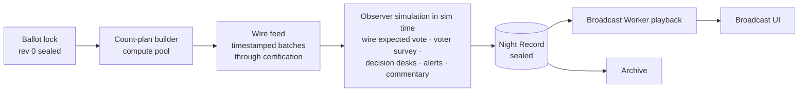

# 08 — Election-Night Architecture

## 8.1 Pipeline

The whole night, plus the days of counting that follow, is computed **once**, right after the ballot
lock, in a few seconds. It is then *played*. The result is fixed before the first poll closes (spec §10.2).
Playback speed, pausing, seeking and replays cannot affect it (spec §1.7), and a replay is the original
record (spec §14.5).

## 8.2 Poll-closing schedule

- State law gives the closing time in **local** time (rules data, 2016 baseline). Each RJ converts it
  through its county's time zone (§3.6), so split-zone states close in waves.
- A state is **closed** for projection purposes when its *last* polling place is scheduled to close. Desks never
  project a state before then.
- A "voters in line" tail is modeled: Election-Day ballots from the busiest precincts arrive at the precinct
  tally up to 10–90 minutes after closing.
- Broadcast hours: coverage opens at **5:00 pm ET** with pre-election framing (forecasts from Phase 5, key
  races, closing schedule). The first closings in a 2016-rules universe are at 6:00 pm ET (eastern
  Indiana and Kentucky). The last are at 1:00 am ET (Aleutians).

## 8.3 Count-plan builder

**Inputs:** rev-0 results at (BU, mode, contest), synthetic precincts (RUs), RJ administrative profiles, and
state counting rules (when mail may be processed or tabulated, ballot receipt deadlines, cure periods,
provisional adjudication, canvass and certification deadlines).

**RJ administrative profile** (persistent per RJ, evolving slowly with funding and law): tabulation capacity by
mode (ballots/hour), reporting cadence (how often the RJ pushes results to the wire: 5–30 min), reporting
style (incremental vs. large dumps), precinct transmission speed (rural precincts are fast; large urban centres
are slower), glitch propensity, staffing for post-election counting.

**Batching, exact by construction.**

1. **Election Day in person.** Each synthetic precinct (a group of BUs) completes at a drawn time
   `t_close + transmit(size, distance, capacity) + queue`. When the RJ's next cadence tick comes, all newly
   completed precincts are combined into one batch. Precincts never split, so "precincts reporting" is
   exact.
2. **Early in person and pre-processed mail.** In states that allow pre-processing, a first large batch arrives
   shortly after the RJ's polls close. Otherwise the batches are scheduled into the night by capacity.
3. **Mail counted from Election Day.** Processing runs at capacity across the night and the following days.
   Each BU's mail ballots are split across batches with BU-specific timing skew: ballots from areas with younger,
   later-returning voters arrive later. Composition shifts emerge from real geographic heterogeneity, not
   from a scripted bias.
4. **Late-arriving mail** (postmark rules), **cured** ballots, **UOCAVA** and **provisional** ballots go into
   later batches over days and weeks, ending at canvass.
5. **Allocation of votes to batches.** For each (BU, mode), the ballots are split into chunks across
   batches. Each chunk's votes in every contest are drawn by **multivariate hypergeometric sampling without
   replacement** from that (BU, mode, contest)'s remaining votes. The last chunk takes the remainder. Batches
   therefore partition the final totals exactly. Every contest in a chunk draws from the same chunk of ballots,
   so votes + undervotes = ballots per contest per batch. Nothing can be counted twice, and cumulative
   totals can never exceed rev 0.
6. **Reporting glitches** (rare): a data-entry error is published as a batch and later reversed by a
   *correction* batch. Both stay in the feed (realistic, and visible in the replay). Corrections never make
   cumulative totals negative.

**Batch record:** `(time, rj, mode, ballots, precinctsCompletedAfter, ruIds[], contestDeltas[])`. About 70k
batches per general election. Compressed size ≈ 1–1.5 MB (§7.4).

## 8.4 Leads and reversals are emergent

Early leads change for exactly three reasons, all mechanical consequences of the data:

1. **Mode composition:** the universe's partisan mode gap `γ_m(t)` (§4.5.2) makes, say, mail lean one way and
   Election Day the other.
2. **Reporting order across geography:** small rural RJs report quickly, and large urban RJs are slower and
   come in big batches.
3. **State counting rules:** whether mail is reported first (pre-processing allowed) or last.

The engine never inspects the race to decide when to reverse a lead. There is no code path that could do
so. A test asserts that the count-plan builder has no access to candidate identities or margins beyond what it needs
for the hypergeometric partition.

## 8.5 Wire service and decision desks

**The wire** (working name *National Election Tabulation Service*, NETS) tabulates the feed for all
networks, the role the AP plays in reality. It publishes counts, precincts reporting, and **expected vote**
per RJ:

- **Prior** `T̂_r`: registration × modeled turnout from public information (pre-election early and mail returns
  that states publish, past turnout, competitiveness), with uncertainty.
- **Updates:** completed precincts versus their priors update the RJ's remaining Election-Day estimate. Reported
  mail-received counts bound the mail still outstanding. Late-count states keep wide intervals for days.
- The UI shows "**≈ x% of expected vote counted**" (with its interval in Analyst Mode) separately from
  "**y of z precincts reporting**" (spec §10.6).

**Decision desks.** Each network runs the model in §4.13 with its own parameters:

| Parameter | Flagship (MNN) | Network B | Network C |
|---|---|---|---|
| Call threshold θ_call | 0.995 | 0.999 | 0.99 |
| Stress test (σ_sys ×2) must stay ≥ | 0.95 | 0.98 | 0.90 |
| Weight on voter survey at poll close | medium | low | high |
| Human review latency | 3–10 min | 10–30 min | 1–5 min |
| Retraction threshold | 0.90 | 0.95 | 0.85 |

Network B and C are working names, with the final fictional names checked against real outlets before Phase 4.

**Status definitions (explicit criteria):**

| Status | Criterion |
|---|---|
| **Poll-close call** | All polls in jurisdiction closed, pre-election prior P ≥ 0.999, survey P ≥ 0.999 in the same direction, and survey margin ≥ 10 pts |
| **Too Early to Call** | At poll close, a leader is expected (combined P ≥ 0.80) but call criteria are unmet |
| **Too Close to Call** | At poll close with P < 0.80, or at any time with ≥ 50% expected vote counted and P < 0.90 |
| **Projection (call)** | P(leader) ≥ θ_call **and** the stress test passes **and** P(final margin inside the automatic-recount threshold) < 0.05 **and** the minimum evidence rule (≥ 25% expected vote counted, or a poll-close call) |
| **Retraction** | After a call, P(called candidate) < retraction threshold → "Projection withdrawn". The race returns to Too Close to Call and can be called again later. |
| **Runoff projected** | In majority-rule contests, P(no candidate > 50%) ≥ θ_call, with the two advancing candidates projected separately |
| **Control projected** | Called seats for a party reach a majority (counting holdovers and the VP tiebreak) |
| **President projected** | Called electoral votes for a candidate ≥ 270 |

**Incorrect calls are rare and consequential.** They happen only when reality violates a desk's assumptions,
for example a correlated survey error together with unusually skewed early returns. A long-run test over hundreds of
simulated nights targets a flagship wrong-call rate below 1 per 500 calls and records every one. A wrong
call that is not retracted before certification becomes a permanent archive note and a news story.

## 8.6 Alerts and commentary

**Alerts** are deterministic detectors over the record. Each has a classification, an importance score and a cooldown:

| Alert | Trigger |
|---|---|
| Polls Closed | Scheduled closing (grouped by time) with the status of each race at close |
| Key Race Alert | First votes, lead change, or a significant margin move in a key race (key = forecast-competitive or control-relevant) |
| Race Projection | Desk call (with "hold" / "flip" and balance-of-power impact) |
| Too Close / Too Early | Status assignments per §8.5 |
| Congressional Control | Majority projected, or the path to majority narrowed to one party |
| Electoral College | Projected EV changes; 270 reached |
| Major County Report | A batch above a size threshold, a big-county completion, or a bellwether completion |
| Recount Watch | Projected final margin inside an automatic or requestable recount threshold |
| Projection Withdrawn | Retraction |

**Commentary** is a structured pipeline, not free text:

1. **Story detection.** Detectors emit typed `StoryCandidate`s with facts drawn only from the record and archive:
   `LeadChange{contest, newLeader, causeBatches:[rj, size, mode]}`, `MarginMove`, `OutstandingVote{where,
   byMode, expectedBeneficiary}`, `Overperformance{candidate, vsComparable, countedUnits}`,
   `BellwetherComplete{county, record}`, `TurnoutNote`, `Projection{flip|hold, controlImpact}`,
   `ControlUpdate`, `PathsTo270`, `LateCountExpectation`, `HistoricNote{firstSince}`.
2. **Scheduling.** The highest-importance story wins the next speaking slot, subject to per-contest and
   per-type cooldowns, a novelty requirement (facts must have changed materially since the last story on that subject) and speaker
   rotation (anchor, data analyst at the map wall, political analysts, field reporters at campaign
   headquarters).
3. **Realization.** Each story type has 10–30 templates per speaker style. Optional clauses carry
   preconditions (for example, *"However, substantial votes remain in {rj}"* is used only if the outstanding-vote facts support it).
   Numbers are rounded sensibly ("about 40,000 votes"). Synonym sets are used, and an LRU of recent template IDs and
   recently used phrase n-grams prevents repetition. Historical comparisons query the archive ("the first
   Republican to carry Erie County since 2024").
4. **Validation.** Every slot is typed and must be bound to a fact. A line that cannot be fully bound is dropped.
5. Lines are stored in the record, so replays are word-for-word identical.

The spec's example (Pennsylvania narrowing after western counties report, with Philadelphia outstanding) is
exactly a `MarginMove` story with a cause clause and an `OutstandingVote` clause.

## 8.7 Playback engine (Broadcast Worker)

- **State at time t** is a pure function of the record: cumulative feed up to `t`, desk statuses at `t`,
  alerts and lines up to `t`. Seeking uses binary search over the time-sorted batch index plus in-memory checkpoints
  every 1,000 batches. A full recomputation from zero is about 1M additions (a few ms).
- **Diff streaming:** the worker sends compact diffs (changed contests, RJs and statuses) to the main thread at
  ≤ 10 Hz. Animations run on the main thread from those diffs.
- **Controls:** pause/play; speeds 1×, 10×, 30×, **60× (default)**, 120×, 300×, 600×; jump to next poll closing,
  next projection, next Key Race Alert, next lead change in the focused race, or end of night; a timeline scrubber
  with event markers; rewind.
- **Spoiler protection:** on first live viewing, seeking forward past the furthest-watched time requires
  confirmation ("Skip ahead"). Rewinding is always allowed. Archived replays allow free seeking.
- **Skipping the night:** advancing the universe past Election Day without watching is allowed. The record
  exists either way and can be watched later as a replay.

## 8.8 After election night

- Later batches (day 2, day 3, …) surface as dated news items and update results views as the universe clock
  passes their timestamps. Desks keep calling races on those days.
- Canvass, curing and provisional adjudication produce rev 2. Certification follows state deadlines (rev 3).
- Recount triggers (automatic or requested) follow state rules (§7.3). Legal disputes are Phase 9 events with
  courts, filings and rulings. They can change the certified result only through modeled outcomes such as ordering a
  recount or settling ballot-validity disputes in specific counts.
- Presidential: electors meet on the statutory date, Congress counts in January, faithless electors (rare, per
  state law, Phase 9) are possible, and the **12th-Amendment contingent election** (House by state delegation, Senate
  for VP) happens when no candidate has a majority. The minimal version is in Phase 2.

## 8.9 Cost (estimates; budgets in §11)

| Step | Work | Target on reference Chromebook |
|---|---|---|
| Count plan | ~2M (BU, mode) chunks × ~3 contests hypergeometric | ≤ 4 s (pool) |
| Observer simulation | ~70k batches; desk evaluations analytic, O(RJs in contest), Monte Carlo only near thresholds | ≤ 3 s |
| Record encode + seal + write | ~2 MB | ≤ 1 s |
| Playback frame | diff of changed entities | ≤ 4 ms main thread |
